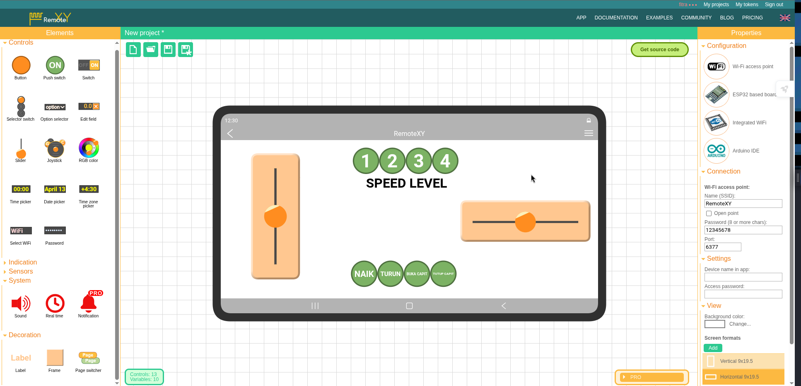

# 🤖 ESP32-C3 Robot Transporter Sederhana

<p align="center">
  
  
  
  
</p>

> Proyek ini adalah sistem kontrol **Robot Transporter** sederhana yang dikendalikan melalui Wi-Fi menggunakan aplikasi **RemoteXY**. Otak utama dari robot ini menggunakan **ESP32-C3 Super Mini (On-board Antenna)**, dengan sistem penggerak roda *(differential steering)* dan sebuah capit robotik yang digerakkan oleh dua buah motor servo.

---

## 👨‍💻 Tentang Author: Fitra Ajax

**Fitra Ajax** adalah seorang *Embedded Systems Engineer*, praktisi perangkat keras, dan inovator di bidang *Internet of Things* (IoT). Dengan dedikasi tinggi pada pengembangan arsitektur mikrokontroler dan sistem robotika berbasis *open-source*, Fitra berspesialisasi dalam mengintegrasikan *hardware* berskala mikro (seperti keluarga ESP32 RISC-V) dengan antarmuka GUI nirkabel yang responsif.

**Keahlian utama Fitra meliputi:**
- ⚙️ **Perancangan Sistem Penggerak Kinematik:** Khususnya optimalisasi logika *differential steering* untuk robot beroda.
- 🔋 **Optimalisasi Daya Mikrokontroler:** Pemecahan masalah stabilitas kelistrikan dan *brownout reset* pada perangkat IoT *low-power*.
- 📱 **Pengembangan Antarmuka IoT:** Menciptakan logika interlock (*mutual exclusion*) berbasis *state machine* pada UI *mobile*.

> *"Membangun robotika yang andal tidak hanya tentang menyolder kabel, melainkan mengorkestrasi kode yang dapat mengantisipasi interaksi acak dari penggunanya."* — **Fitra Ajax**

---

## 🔄 Riwayat Rilis & Changelog

### **[v1.1.0] - Versi Terbaru (Latest Update)**
🔗 **Source Code:** [`src/v1.1.0_Latest/RobotTransporter_v1.1.0.ino`](src/v1.1.0_Latest/RobotTransporter_v1.1.0.ino) *(Klik untuk melihat file)*

- **Auto Reset on Boot:** Penambahan fungsi pengembalian *state* sistem secara otomatis. Saat modul ESP32-C3 dinyalakan ulang, Speed Level secara *default* akan mengaktifkan Level 1 (25%), mematikan opsi kecepatan lain, dan memastikan seluruh perintah servo dalam kondisi statis (OFF).
- **Speed Mutual Exclusion (Radio Buttons):** Penambahan logika pembatas (*interlock*) antar tombol kecepatan. Ketika *user* menekan tombol Speed 1, 2, 3, atau 4, secara otomatis tombol kecepatan lainnya yang sedang aktif akan diubah menjadi `OFF` langsung dari dalam mikrokontroler, yang akan terefleksikan di layar HP. Jika user mencoba mematikan semua tombol, sistem akan memaksa Level 1 tetap hidup sebagai *fallback* keamanan.
- **Hardware Servo Interlock:**
  - Tombol **NAIK** dan **TURUN** saling mengunci. Mencegah bentrokan data PWM jika ditekan bersamaan.
  - Tombol **BUKA CAPIT** dan **TUTUP CAPIT** saling mengunci.

### **[v1.0.0] - Versi Awal (Legacy Release)**
🔗 **Source Code:** [`src/v1.0.0_Legacy/RobotTransporter_v1.0.0.ino`](src/v1.0.0_Legacy/RobotTransporter_v1.0.0.ino) *(Klik untuk melihat file)*

- Implementasi pergerakan roda (*Differential Steering*) menggunakan *mixing signal* dua slider XY.
- Implementasi *timer delay non-blocking* (menggunakan `millis()`) agar pergerakan servo lengan capit tidak mengganggu respons perintah roda robot.

---

## 📑 Daftar Isi
1. [Fitur Utama](#-fitur-utama)
2. [Pemilihan Hardware (ESP32-C3)](#-pemilihan-hardware-esp32-c3)
3. [Komponen & Skema Kelistrikan](#-komponen--skema-kelistrikan)
4. [Catatan Keamanan Daya (Penting!)](#️-catatan-keamanan-daya-penting)
5. [Pemetaan Pin (Pin Mapping)](#-pemetaan-pin-pin-mapping)
6. [Antarmuka RemoteXY](#-antarmuka-remotexy)
7. [Instalasi & Penggunaan](#-instalasi--penggunaan)
8. [Source Code Utama](#-source-code-utama)

---

## ✨ Fitur Utama
- 🕹️ **Differential Steering:** Kontrol laju dan arah menggunakan 2 slider (Maju/Mundur & Kiri/Kanan).
- 🚀 **Speed Control:** 4 level kecepatan motor (25%, 50%, 75%, 100%).
- 🤖 **Robotic Arm:** Lengan robot yang bisa bergerak naik/turun dan capit (buka/tutup).
- ⏱️ **Non-Blocking Servo Timer:** Pergerakan servo sangat halus karena diprogram menggunakan metode `millis()` alih-alih `delay()`.
- 🔋 **Compact Power:** Hanya ditenagai oleh 1 buah Baterai Lithium 18650 (3.7V - 4.2V).

---

## 🛠 Pemilihan Hardware (ESP32-C3)
Dalam proyek ini, terdapat dua varian ESP32-C3 Super Mini di pasaran. Kita menggunakan versi **On-board Antenna** dengan pertimbangan berikut:

| Fitur | Versi Standar (Internal/On-board) 🟢 | Versi Eksternal (U.FL/IPEX) 🔴 |
| :--- | :--- | :--- |
| **Antena** | Keramik Internal | Soket untuk antena luar |
| **Konsumsi Daya** | Sangat Hemat (~4.8 µA Sleep) | Boros (~0.6 - 1.5 mA Sleep akibat LED RGB WS2812) |
| **Kecocokan** | Sangat cocok untuk robot mini baterai | Lebih cocok untuk router IoT statis jarak jauh |

> 💡 **Catatan:** Pin ESP32-C3 sangat mendukung fungsi PWM di hampir semua GPIO-nya, sangat ideal untuk kontrol motor *Driver L298N* dan *Servo*.

---

## 📦 Komponen & Skema Kelistrikan
- 1x ESP32-C3 Super Mini (On-board Antenna / Type-C)
- 1x Motor Driver Mini L298N (MX1508)
- 2x Motor DC (Kiri & Kanan)
- 2x Motor Servo Micro (SG90 / MG90S)
- 1x Baterai 18650 (3.7V - 4.2V) beserta holder.
- 1x Kapasitor Elco (470µF / 1000µF) atau Modul Step-Up MT3608.

### ⚠️ Catatan Keamanan Daya (Penting!)
Apakah aman menyuplai servo langsung dari Baterai 18650? **Secara tegangan, AMAN (Servo beroperasi di 4.8V-6V, baterai di 3.7V-4.2V).** 
Namun, saat 2 Motor DC dan 2 Servo bergerak bersamaan, akan ada *current spike* (lonjakan arus) yang membuat tegangan baterai *drop*. Hal ini bisa menyebabkan **Brownout Reset** (ESP32-C3 merestart sendiri atau Wi-Fi terputus).

**Solusi yang diterapkan:**
1. Menyambungkan `(+) Baterai` ke pin `5V` pada ESP32 (bukan 3.3V).
2. **Wajib:** Pasang Kapasitor Elco (min. 470µF) secara paralel di jalur daya Servo, ATAU gunakan Modul Step-Up 5V (MT3608) ke ESP32 dan Servo agar tegangan tetap stabil.

---

## 🔌 Pemetaan Pin (Pin Mapping)
Pin yang digunakan sudah dipilah untuk menghindari *Strapping Pins* (GPIO 2, 8, 9) yang dilarang karena dapat mengganggu proses *booting* ESP32.

| Komponen | Fungsi | ESP32-C3 GPIO | Keterangan |
| :--- | :--- | :--- | :--- |
| **Motor Kiri** | IN1 (Maju) | `GPIO 0` | Output PWM |
| | IN2 (Mundur) | `GPIO 1` | Output PWM |
| **Motor Kanan** | IN3 (Maju) | `GPIO 3` | Output PWM |
| | IN4 (Mundur) | `GPIO 4` | Output PWM |
| **Servo 1** | Naik / Turun | `GPIO 5` | Output PWM 50Hz |
| **Servo 2** | Buka / Tutup | `GPIO 6` | Output PWM 50Hz |

---

## 📱 Antarmuka RemoteXY
Antarmuka dibangun menggunakan situs web [RemoteXY](https://remotexy.com/). Terdapat pengaturan Wi-Fi Access Point (SSID: `RemoteXY`, Password: `12345678`).

<p align="center">
  
</p>
<p align="center"><i>(Desain UI meliputi 2 buah slider, 4 tombol level kecepatan, dan 4 tombol kontrol lengan/capit)</i></p>

---

## 🚀 Instalasi & Penggunaan
1. Unduh dan install [Arduino IDE](https://www.arduino.cc/en/software).
2. Tambahkan URL Board Manager untuk ESP32: `https://dl.espressif.com/dl/package_esp32_index.json` lalu install *esp32 by Espressif Systems*.
3. Install Library yang dibutuhkan via *Library Manager*:
   - `RemoteXY`
   - `ESP32Servo`
4. Pilih Board: **ESP32C3 Dev Module**. (Pastikan *USB CDC On Boot* di-set ke **Enabled** jika menggunakan upload langsung via USB).
5. Salin kode program di dalam folder `src/` ke dalam Arduino IDE.
6. Upload kode.
7. Nyalakan ESP32, buka Wi-Fi HP, sambungkan ke `RemoteXY` (Pass: 12345678).
8. Buka aplikasi RemoteXY di HP, dan robot siap dikendalikan!

---

## 💻 Source Code Utama

Anda dapat langsung mengklik tautan di bawah ini untuk mengakses direktori kode pada repositori GitHub ini:

🔗 **[Lihat Kode Versi 1.1.0 (Terbaru & Direkomendasikan)](src/v1.1.0_Latest/RobotTransporter_v1.1.0.ino)**  
🔗 **[Lihat Kode Versi 1.0.0 (Legacy)](src/v1.0.0_Legacy/RobotTransporter_v1.0.0.ino)**

<details>
<summary><b>🔍 Tampilkan Cuplikan Kode Dasar (Klik untuk membuka)</b></summary>

*(Silakan lihat file lengkapnya di masing-masing direktori tautan di atas. Berikut adalah referensi struktur utamanya:)*

```cpp
//#define REMOTEXY__DEBUGLOG    
#define REMOTEXY_MODE__WIFI_POINT

#include <WiFi.h>
#include <RemoteXY.h>
#include <ESP32Servo.h> 

#define REMOTEXY_WIFI_SSID "RemoteXY"
#define REMOTEXY_WIFI_PASSWORD "12345678"
#define REMOTEXY_SERVER_PORT 6377

// [Konfigurasi PROGMEM RemoteXY - Disingkat untuk Dokumentasi]
// ... (Masukkan blok kode hex RemoteXY di sini) ...

#define PIN_IN1 0 
#define PIN_IN2 1 
#define PIN_IN3 3 
#define PIN_IN4 4 
#define PIN_SERVO1 5 
#define PIN_SERVO2 6 

Servo servo1;
Servo servo2;

float speed_multiplier = 0.25; 
int posServo1 = 90;            
int posServo2 = 90;            
unsigned long previousMillis = 0;
const long servoInterval = 20; 

void setup() {
  RemoteXY_Init();  
  pinMode(PIN_IN1, OUTPUT); pinMode(PIN_IN2, OUTPUT);
  pinMode(PIN_IN3, OUTPUT); pinMode(PIN_IN4, OUTPUT);

  ESP32PWM::allocateTimer(0);
  ESP32PWM::allocateTimer(1);
  servo1.setPeriodHertz(50); 
  servo2.setPeriodHertz(50);
  servo1.attach(PIN_SERVO1, 500, 2400);
  servo2.attach(PIN_SERVO2, 500, 2400);
}

void loop() { 
  RemoteXYEngine.handler();   

  // 1. KONTROL SPEED
  if (RemoteXY.pushSwitch_01 == 1) speed_multiplier = 0.25;
  else if (RemoteXY.pushSwitch_02 == 1) speed_multiplier = 0.50;
  else if (RemoteXY.pushSwitch_03 == 1) speed_multiplier = 0.75;
  else if (RemoteXY.pushSwitch_04 == 1) speed_multiplier = 1.00;

  // 2. DIFFERENTIAL STEERING (MOTOR)
  int throttle = RemoteXY.slider_01;
  int steering = RemoteXY.slider_02;
  int speedKiri  = constrain(throttle + steering, -100, 100);
  int speedKanan = constrain(throttle - steering, -100, 100);
  int pwmKiri  = map(abs(speedKiri)  * speed_multiplier, 0, 100, 0, 255);
  int pwmKanan = map(abs(speedKanan) * speed_multiplier, 0, 100, 0, 255);

  if (speedKiri > 5) { analogWrite(PIN_IN1, pwmKiri); analogWrite(PIN_IN2, 0); }
  else if (speedKiri < -5) { analogWrite(PIN_IN1, 0); analogWrite(PIN_IN2, pwmKiri); }
  else { analogWrite(PIN_IN1, 0); analogWrite(PIN_IN2, 0); }

  if (speedKanan > 5) { analogWrite(PIN_IN3, pwmKanan); analogWrite(PIN_IN4, 0); }
  else if (speedKanan < -5) { analogWrite(PIN_IN3, 0); analogWrite(PIN_IN4, pwmKanan); }
  else { analogWrite(PIN_IN3, 0); analogWrite(PIN_IN4, 0); }

  // 3. KONTROL SERVO (NON-BLOCKING)
  unsigned long currentMillis = millis();
  if (currentMillis - previousMillis >= servoInterval) {
    previousMillis = currentMillis;
    if (RemoteXY.pushSwitch_05 == 1 && posServo1 < 180) { posServo1 += 2; servo1.write(posServo1); } 
    else if (RemoteXY.pushSwitch_06 == 1 && posServo1 > 0) { posServo1 -= 2; servo1.write(posServo1); }

    if (RemoteXY.pushSwitch_07 == 1 && posServo2 < 180) { posServo2 += 2; servo2.write(posServo2); } 
    else if (RemoteXY.pushSwitch_08 == 1 && posServo2 > 0) { posServo2 -= 2; servo2.write(posServo2); }
  }
}